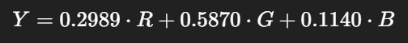
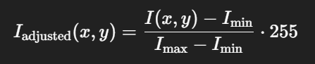
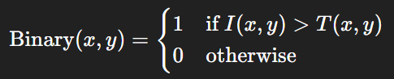
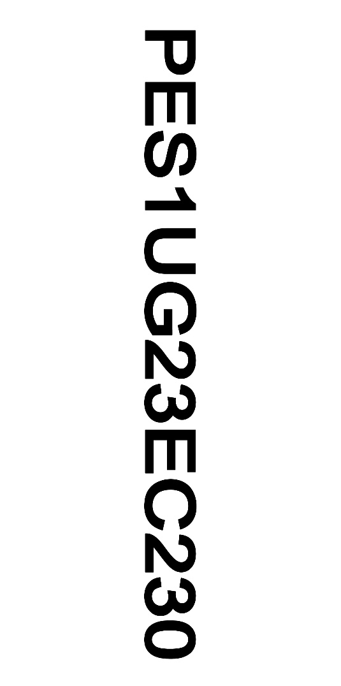
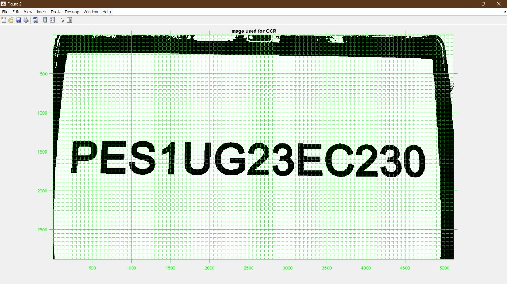
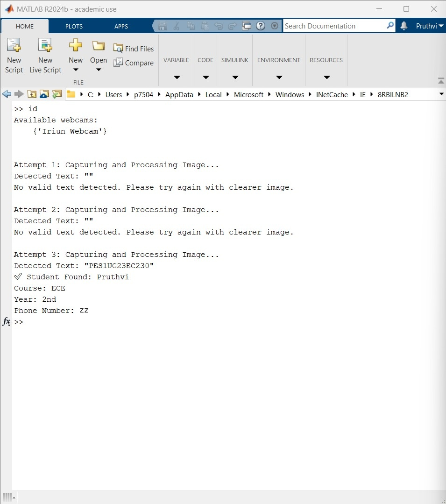
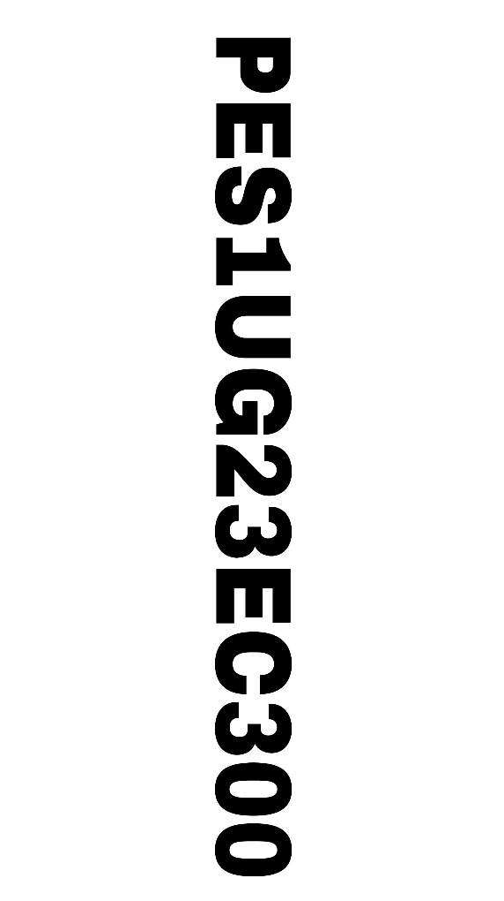
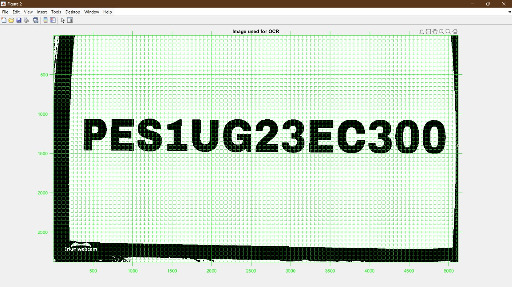
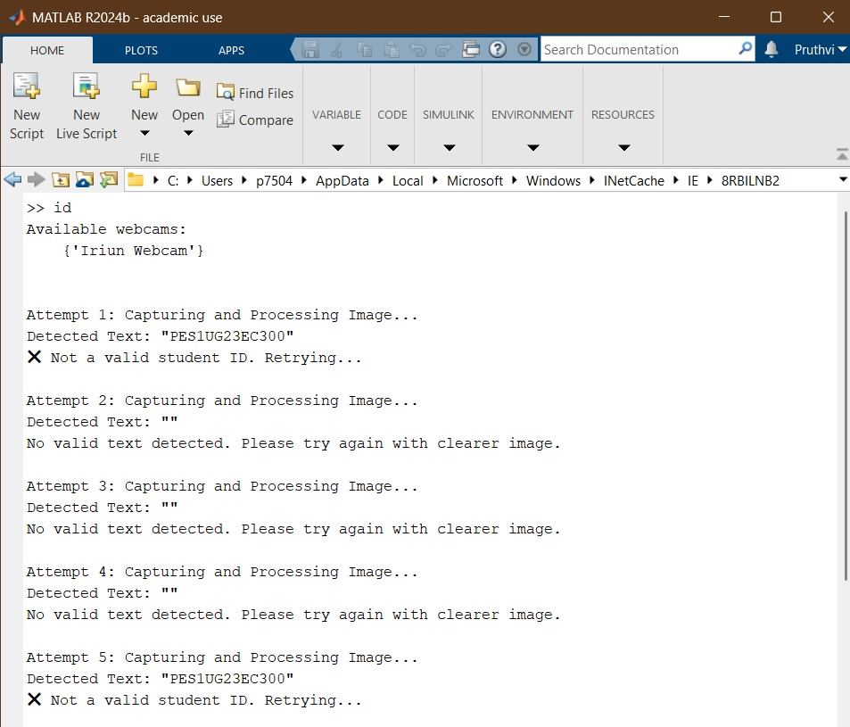

# Student ID Recognition using OCR and DSP (MATLAB)

A MATLAB project that reads a student's **SRN** from an ID card using a webcam.
It cleans up the image with digital signal processing techniques, reads the
text with OCR, and looks the SRN up in a student database to display that
student's details.

It's built for modern colleges, for two purposes:
- **Campus security:** only registered students can enter.
- **Class attendance:** students are marked present when they scan.

---

## Team members

| Name | SRN |
|---|---|
| Pruthvi | PES1UG23EC230 |
| Rakesh DN | PES1UG24EC808 |
| Nikhil Babu | PES1UG23EC200 |
| Nikhil N | PES1UG23EC203 |

---

## Problem statement

To detect the text (SRN) using digital signal processing and display the
respective details of the student using MATLAB.

---

## Purpose: campus security

This project is an **automated entry check for modern colleges**. Only
registered students are allowed onto the campus.

- At the entrance, each person shows their ID card to the camera.
- The system reads the SRN and checks it against the college's student database.
- ✅ **Registered student:** the SRN is found and the student's details (name,
  course, year, phone number) are displayed, so **entry is allowed**.
- ❌ **Unauthorised person:** the SRN isn't in the database, or no valid ID is
  shown, so **entry is denied**.
- 📝 **New student or visitor:** they must first **register with the college**.
  They're given a new SRN and ID card, and their details are added to the
  database. After that, they can scan and enter like any other student.

This replaces manual ID checking by security staff with a faster, automatic
check that can't be fooled by an ID number that isn't on record.

## Purpose: class attendance

The same ID scan can also be used to **mark attendance** for classes:

- Students scan their ID card at the classroom entrance.
- When the SRN is found in the database, that student is identified and marked
  **present** for the class.
- SRNs that aren't in the database aren't counted, so attendance can't be
  marked for someone who isn't registered.

This removes the need for roll calls or paper registers and saves class time.

---

## Tools

1. MATLAB
2. Webcam
3. Image Processing Toolbox
4. Signal Processing Toolbox
5. Computer Vision Toolbox (for OCR)

---

## Repository structure

```
├── code/
│   └── DSPjackfruit.m          # main script: webcam → preprocessing → OCR → database lookup
├── database/
│   └── create_studentDB.m      # builds studentDB.mat (student records)
├── simulation_results/         # input images, OCR images and MATLAB outputs
├── docs/
│   └── formulas/               # formula images used in the explanation below
└── README.md
```

---

## How it works

```
Webcam snapshot → Grayscale → Median filter → Sharpen → Contrast adjust
→ Resize (×2) → Adaptive binarization → Median filter → OCR → Database lookup
```

1. The script captures an image from the webcam.
2. The image goes through the preprocessing steps below so the text is clear.
3. OCR reads the text. It only accepts the characters `A–Z` and `0–9`.
4. If the detected text matches an SRN in the database, the student's name,
   course, year and phone number are displayed.
5. If nothing is detected or the SRN isn't in the database, the script tries
   again, up to **10 attempts**.

---

## Formulas used

### 1. Grayscale conversion


This is a weighted sum that converts RGB values into grayscale intensity
(`rgb2gray`).

### 2. Median filtering (noise reduction)
For each 3×3 neighbourhood:
1. Collect all 9 pixel values.
2. Sort them.
3. Take the median (middle value).

Example:
```
input : [34, 120, 56, 98, 240, 130, 75, 45, 67]
sorted: [34, 45, 56, 67, 75, 98, 120, 130, 240]
median: 75
```
Implemented with `medfilt2`.

### 3. Sharpening (image enhancement)


This is a high-pass filter approximation. α controls the level of sharpening,
commonly between 0.2 and 1 (`imsharpen`).

### 4. Contrast adjustment


This scales pixel intensities to the full range [0, 255]. I<sub>min</sub> and
I<sub>max</sub> are the minimum and maximum grayscale values in the image
(`imadjust`).

### 5. Thresholding / binarization
Adaptive threshold:


Where:
- μ(x, y) is the local mean
- σ(x, y) is the local standard deviation
- R is the dynamic range of the standard deviation
- k is a tuning parameter (e.g. 0.3–0.5)

Each pixel:



Implemented with `imbinarize(..., 'adaptive', 'Sensitivity', 0.4)`.

---

## How to run

1. Install MATLAB with the Image Processing, Signal Processing and Computer
   Vision toolboxes, plus the **MATLAB Support Package for USB Webcams**.
2. Connect a webcam. A phone camera through an app such as Iriun Webcam also works.
3. Open the `code/` folder in MATLAB.
4. Optional: run `database/create_studentDB.m` from that folder to create
   `studentDB.mat`. If the file doesn't exist, the main script creates it
   automatically.
5. Run `DSPjackfruit.m` and hold the ID card (SRN) in front of the camera.

> Phone numbers in this repository are replaced with placeholders
> (`xx`, `yy`, `zz`, `aa`) for privacy.

---

## Results

### Test 1: Registered student (`PES1UG23EC230`)

| Input | Image used for OCR |
|---|---|
|  |  |

Output: the SRN is detected on attempt 3. The student is found in the database,
their details are displayed, and entry is allowed.



### Test 2: Unregistered SRN (`PES1UG23EC300`)

| Input | Image used for OCR |
|---|---|
|  |  |

Output: the SRN is read correctly but isn't in the database, so the script
reports **"Not a valid student ID"** and entry is denied. This person would
have to register with the college first.



---

## Conclusion

This MATLAB project combines webcam input, DSP-based image enhancement and OCR
to build an automated security check at the college entrance. Preprocessing
(grayscale conversion, median filtering, sharpening, contrast adjustment and
adaptive thresholding) makes the SRN on the ID card clear enough for OCR to
read reliably.

- **Registered students:** their SRN is found in the database, their details
  are displayed and they can enter.
- **Unregistered SRNs:** the system shows **"Not a valid student ID"**, and the
  person isn't allowed in.
- **New students or visitors:** they must first register. They're given a new
  SRN and ID card and added to the database (see `database/create_studentDB.m`),
  after which they can scan in like everyone else.

- **Attendance:** the same scan identifies the student in class, so their
  attendance can be marked automatically.

The system shows an efficient, low-cost way for modern colleges to secure
their campus and take class attendance with real-time automated student
identification.
